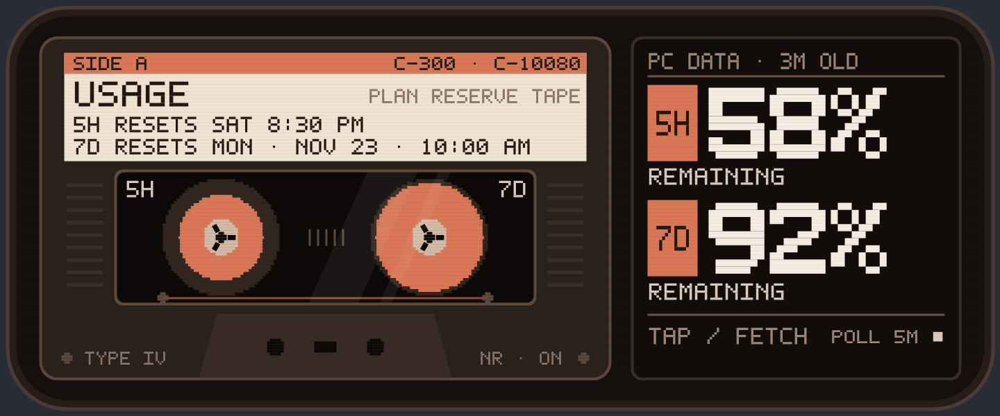

# Data Cassette: a tape in the deck

**Experimental.** One widget drawn as a cassette in a deck. Each reel is a reserve: the left reel holds the five-hour reserve and the right reel the weekly one. Tape winds off a reel as that reserve is used.



*Layout preview drawn offline from sample data by `tools/preview.py`. It is not a phone screenshot.*

## Reading it

| Part | Shows |
|---|---|
| Reels | Tape left, in twenty steps. A reel turns yellow below 10%, cream when full, and grey when the reading is not fresh. The dark ring behind the tape marks a full reel. |
| Paper label | The reset time of each reserve, written like a track listing. |
| Label band | `C-300` and `C-10080` are the two windows in minutes, the way a C-90 tape is named for its length. |
| Panel | Both percentages, a status word for each, the age of the PC's reading, and the tap prompt. The small lamp follows the weekly row. |
| Reel hubs | Turn a third of a turn each minute the widget redraws. Decoration only. |

Tap the cassette or the panel to refresh; tap the top strip to edit.

## What it needs

The same feed as [Ember Dual](DUAL.md#what-it-needs): a `fiveHour` and a `weekly` object plus `refreshedAt`.

## Build and load it

Use Python 3.10+:

```sh
python tools/cassette.py --label CLAUDE --output local/cassette
```

Import `local/cassette/Data_Cassette_CLAUDE.kwgt` into KWGT, set **Globals → Source** to your feed URL without query strings, and **Save**. The label title takes up to 20 characters from the pixel alphabet.

To review a layout change without a phone:

```sh
python tools/preview.py --design cassette --label CLAUDE --output local/cassette
```

## How it is made

`tools/cassette.py` reuses Phosphor Classic's formulas the same way `tools/dual.py` does: percentages, status words, reset times, colours and the single tap action are the theme's own, moved and recoloured, with the left side reading `.fiveHour.`.

| Part | How |
|---|---|
| Reels | The theme's twenty meter cells, with their colour formulas unchanged. Each cell is drawn as a disc instead of a box, largest first, so the lit discs form the tape pack. |
| Shapes | Rectangles and native paths only, like every theme. Discs are stacks of pixel rows, so they use the same path commands as the lettering. |
| Track listing | The theme's reset-time characters in a fixed ink colour on the paper label. |
| Hub turn | The one new formula. It picks one of three hub drawings from the minute, using only functions the themes already use. If it fails, the hubs stand still and nothing else is affected. |

## What is verified

The offline tests check that both sides' formulas match Phosphor Classic's apart from the documented differences, that each reel is the twenty cells in the right order with its hub on top, that only proven path commands are drawn, that the track listing stays on the label, that text does not collide or leave the card, and that the archive is reproducible and carries no private endpoint.

They do not run Kustom. **On-device behaviour has not been confirmed yet.** Worth checking on a phone: the reels (forty stacked path modules), the hub turn, the eight-field snapshot after a tap, and overall speed with about 150 live modules where the other themes have about 100.
