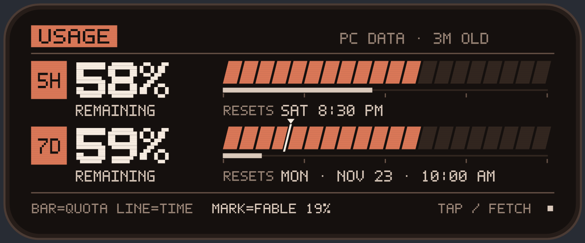

# Ember Dual: two meters in one card

**Experimental.** One widget shows the five-hour reserve above the weekly reserve. Each row has its percentage, a status word, a 20-segment meter, a line for the time left in that window, and the reset time.



*Layout preview drawn offline from sample data by `tools/preview.py`. It is not a phone screenshot.*

## Reading it

| Part | Shows |
|---|---|
| Meter | Reserve left, in twenty segments. Yellow below 10%, cream when full, grey when the reading is not fresh. |
| Line under the meter | How much of the window's time is left, on the same scale as the meter, with quarter marks. |
| Line colour | Red when the line is longer than the meter: less reserve left than time left, so the reserve is being used faster than the clock. Otherwise the label colour. |
| Status word and reset time | As in the other themes, one per row. |
| Needle on the lower meter | A weekly limit that applies to one model, where the feed has one, at its own level on the weekly scale. It can sit well below the all-models meter. Yellow below 10%, grey when the reading is not fresh. |
| `MARK=` text in the footer | That limit's name, as the feed gives it, and its percentage left. |
| Lamp, bottom right | Follows the weekly row. |

Tap the body to refresh; tap the header to edit.

## What it needs

A feed with both a `fiveHour` and a `weekly` object, plus `refreshedAt`:

```json
{
  "fiveHour": { "available": true, "remaining": 32, "resetsAt": "2026-01-01T18:20:00-05:00" },
  "weekly": { "available": true, "remaining": 94, "resetsAt": "2026-01-04T10:00:00-05:00" },
  "refreshedAt": "2026-01-01T15:20:00-05:00"
}
```

Each object follows the [existing contract](CONNECTOR_REFERENCE.md#the-stable-contract). The [Windows tray](https://github.com/arussin/codex-usage) writes this shape for Codex (`usage.json`) and, when its Claude numbers are switched on, for Claude (`claude.json`). A row whose object is missing or unavailable shows `--%` and UNAVAILABLE; the other row still works. The time line assumes a five-hour window for the upper row and a seven-day window for the lower one.

A feed can also carry a `weeklyScoped` object for a weekly limit on one model:

```json
"weeklyScoped": { "label": "Fable", "available": true, "remaining": 19, "resetsAt": "2026-01-04T10:00:00-05:00" }
```

It is optional. Without it, or while it is unavailable, the needle and the footer text do not appear and nothing else changes. The Windows tray writes it in `claude.json`.

## Download it

| Header | File |
|---|---|
| CLAUDE | [Download](../dual/Ember_Dual_CLAUDE.kwgt) |
| CODEX | [Download](../dual/Ember_Dual_CODEX.kwgt) |

In GitHub's file view, choose **Download raw file**, then import it into KWGT. Set **Globals → Source** to your feed URL without query strings, and **Save**. [Checksums](../dual/SHA256SUMS.txt).

## Build it yourself

For another header or palette, use Python 3.10+:

```sh
python tools/dual.py --label CLAUDE --output local/dual
```

Import `local/dual/Ember_Dual_CLAUDE.kwgt` into KWGT, set **Globals → Source** to your feed URL without query strings, and **Save**.

If you move the file to your phone through your own file server, put it inside a zip first. A `.kwgt` file is itself a zip archive, and a server that labels it as one makes the phone save it under a zip name that KWGT will not pick. The header takes up to 20 characters from the pixel alphabet. `--palette phosphor` keeps the mint Phosphor Classic colours instead of the warm Ember ones.

To review a layout change without a phone:

```sh
python tools/preview.py --design dual --label CLAUDE --output local/dual
```

That writes two SVG files with sample readings, one normal and one with a low and a full row.

## How it is made

`tools/dual.py` takes modules from the Phosphor Classic source, the theme checked on a phone, and changes as little as it can:

| Part | How |
|---|---|
| Position and size | Each module gets new coordinates in the same 1440 × 600 design space and scaling formula. |
| Colours | A fixed table maps each Phosphor colour to an Ember colour by role. Low reserve is yellow so it cannot be mistaken for the coral meter. |
| The upper row's data | Its formulas read `.fiveHour.` in place of `.weekly.`, and its own slots of the saved snapshot. Its reset line uses a shorter `EEE h:mm A` format. |
| Meter segments | The theme's twenty meter cells with their colour formulas unchanged, each drawn as a leaning native path instead of a box. |
| Time line | A new formula. It starts from the theme's own reset-time formula, keeps everything up to the validated reset timestamp, and adds one step: the share of the window still to run. If it fails, the line is missing or wrong and nothing else is affected. |
| Per-model limit | The theme's percentage formulas, read from `.weeklyScoped.`. One added step places the needle along the meter and two spell the footer text. Its held-snapshot slots are left empty on purpose, so with only an old snapshot to show it disappears instead of borrowing another limit's reading. If it fails, the needle or text is missing or wrong and nothing else is affected. |

Both rows share one request URL and one source timestamp, so the card makes the same single download as the other themes. The body tap still runs one action. That action is the theme's own formula followed by a copy of its per-metric steps for the five-hour object, and it saves eight fields instead of five: request marker, weekly reading, source time, five-hour reading.

[Freshness, states and troubleshooting](REFRESH.md) apply unchanged.

## What is verified

The offline tests check that the weekly row's formulas are identical to Phosphor Classic's, that the five-hour row differs only in the documented ways, that the time line is the theme's reset formula plus one step built from functions the themes already use, that the per-model needle and footer text are the theme's percentage formulas plus the documented steps, that the tap action has no undefined variable, that text does not collide or leave the card, and that the archive is reproducible and carries no private endpoint.

They do not run Kustom. On 2026-11-21 the user loaded this card on his phone, with the CLAUDE label and the Ember palette, and confirmed that it works and shows his readings. That is one device and one build. Individual parts were not checked one by one: the time line's colour change, the held snapshot after a tap, and speed over a longer period, with about 150 live modules where the other themes have about 100, are still worth watching. Other labels, the Phosphor palette and other devices are untested.

The per-model needle and footer text were added on 2026-11-22, after that phone check. They have not been confirmed on a phone yet.
